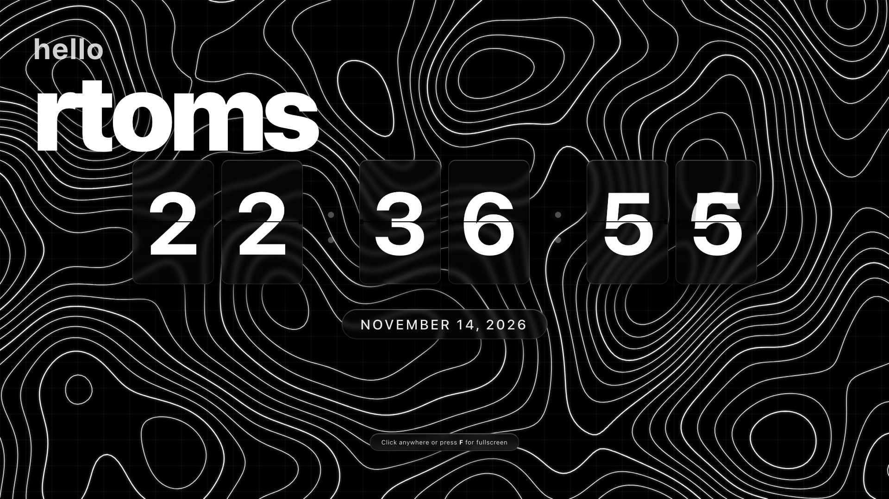
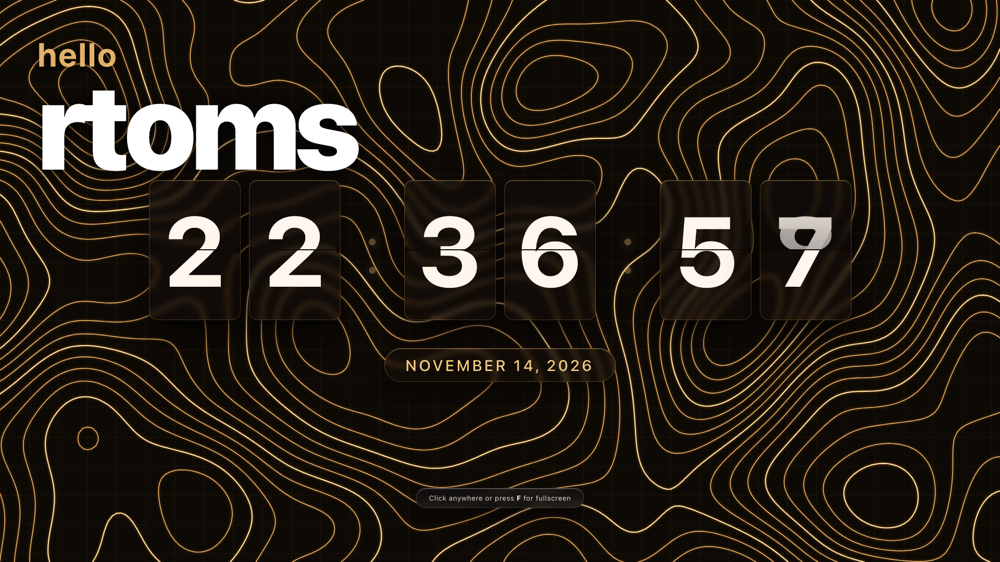
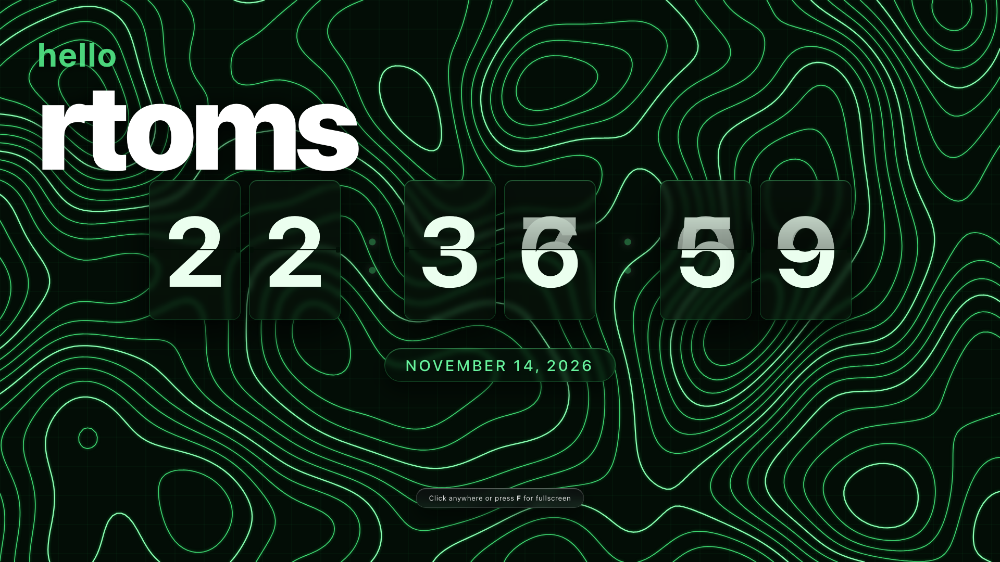
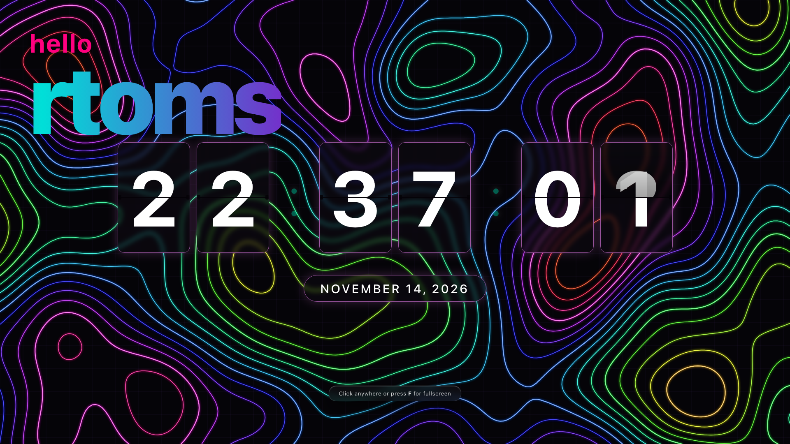

# rtoms screensaver

A minimalist, high-performance web screensaver featuring an animated procedural topographic background and a large 24-hour mechanical 3D flip clock with frosted glassmorphism.

Built with pure modern web standards (HTML5 Canvas 2D, CSS 3D transforms, ES6 JavaScript) with zero external dependencies, no build steps, and full offline support.

---

## Preview

### Monochrome B&W (Default)


### Warm Amber


### Emerald Dark Green


### RGB Gamer Mode


---

## Features

- Procedural Topographic Flow: Continuous 3D Simplex noise and Marching Squares contour extraction running on HTML5 Canvas 2D with soft glow bloom and cartographic grid.
- 24-Hour Mechanical Flip Clock: Centered HH : MM : SS mechanical cards with 3D folding flap physics, realistic crease notches, and system millisecond drift compensation.
- Frosted Glassmorphism: Refined translucent glass styling across the flip cards, date capsule, and bottom action bar with subtle bevel reflections.
- Multiple Themes: Instant hotkey switching between Monochrome B&W, Warm Amber, Emerald Tactical Green, and RGB Gamer Rainbow mode.
- Persistent DOM Architecture: Only animates digits that change (seconds every second; tens of minutes every 10 minutes) for zero memory leaks during multi-hour kiosk runs.
- Bottom-Edge HUD: Control bar stays completely hidden during screensaver operation and glides into view only when the cursor approaches the bottom edge of the screen.
- Auto-Hiding Cursor: The mouse cursor automatically disappears after 2.8 seconds of inactivity.
- Windows Kiosk Launcher: Dedicated double-click batch script for running Microsoft Edge or Chrome in true full-screen kiosk mode.

---

## Keyboard Controls and Shortcuts

| Key | Action |
| :--- | :--- |
| T | Cycle themes (Warm -> Emerald -> Monochrome B&W -> RGB Gamer) |
| F | Toggle Fullscreen mode |
| Space | Pause / Resume topographic contour animation |
| M | Cycle contour density (Low -> Medium -> High) |
| Alt + F4 | Exit Kiosk mode (Windows) |
| Esc | Exit Fullscreen (Standard browser mode) |

Move your cursor to the bottom edge of the screen to reveal the interactive frosted glass control bar.

---

## How to Customize and Make This Yours

`rtoms-screensaver` is designed to be easily personalized. You do not need Node.js, npm, or any build tools to modify it.

### 1. Change the Title and Greeting
Open `index.html` and locate the `<header>` block:
```html
<header class="header-container">
  <div class="site-title" id="site-title">
    <span class="title-subheading">hello</span>
    <h1 class="title-heading">rtoms</h1>
  </div>
</header>
```
- Change `hello` to any subheading (for example: `welcome`, `focus`, or `station`).
- Change `rtoms` to your own name, initials, or handle.

### 2. Adjust Title Font Sizing
Open `style.css` and adjust the clamp values under `.title-subheading` and `.title-heading`:
```css
.title-subheading {
  font-size: clamp(1.8rem, 3.5vw, 4rem);
  font-weight: 700;
}

.title-heading {
  font-size: clamp(5.2rem, 13vw, 14.5rem);
  font-weight: 900;
}
```

### 3. Modify or Add New Color Themes
In `style.css`, color schemes are defined using CSS custom properties on `body[data-theme="..."]`:
```css
body[data-theme="your-theme-name"] {
  --bg-color: #0b0c10;
  --card-bg: rgba(15, 20, 25, 0.35);
  --card-border: rgba(100, 200, 255, 0.25);
  --glass-specular: rgba(100, 200, 255, 0.35);
  --text-color: #ffffff;
  --separator-color: #66fcf1;
  --date-color: #45a29e;
  --subheading-color: #66fcf1;
}
```
In `topography.js`, update the line and grid colors inside the `render()` method to match your theme palette:
```javascript
if (theme === 'your-theme-name') {
  bgColor = '#0b0c10';
  gridColor = 'rgba(100, 200, 255, 0.08)';
  defaultLineColor = 'rgba(100, 200, 255, 0.9)';
  accentLineColor = 'rgba(150, 230, 255, 1.0)';
  glowColor = 'rgba(80, 180, 255, 0.55)';
}
```
Finally, add your theme id to the `themes` list in `app.js`:
```javascript
const themes = [
  { id: 'warm', name: 'Warm' },
  { id: 'darkgreen', name: 'Emerald' },
  { id: 'monochrome', name: 'B&W' },
  { id: 'rgb', name: 'RGB Gamer' },
  { id: 'your-theme-name', name: 'Cyber Blue' }
];
```

### 4. Adjust the Topographic Waves
Open `topography.js` and edit the configuration variables:
- `this.speed = 0.000038;`: Controls how fast the terrain shifts over time. Lower values create slower, more hypnotic motion.
- `this.spatialScale = 0.0013;`: Controls the size of the hills and valleys. Increase for tighter curves; decrease for broad landscape ridges.
- `this.densityPresets`: Controls the number of contour lines per level. Add or remove threshold values in `[0.1, 0.2, ...]` to adjust line spacing.
- `this.gridSpacing = 56;`: Distance in pixels between cartographic background grid lines.

### 5. Adjust the Clock Size
In `style.css`, locate `:root` and modify the fluid variables:
```css
:root {
  --card-width: clamp(3.6rem, 9.8vw, 11rem);
  --card-height: clamp(5.4rem, 15vw, 16.8rem);
  --font-size: clamp(3.8rem, 10.8vw, 12rem);
  --card-radius: clamp(8px, 1.3vw, 16px);
}
```

### 6. Toggle 12-Hour vs 24-Hour Format
Open `app.js` and locate `updateTime()`. To switch to 12-hour format:
```javascript
// Replace:
const hours = String(now.getHours()).padStart(2, '0');

// With:
const rawHours = now.getHours() % 12 || 12;
const hours = String(rawHours).padStart(2, '0');
```

---

## Windows Kiosk Launch Guide

### Quick Start
1. Double-click `launch-kiosk.bat`.
2. Microsoft Edge (or Google Chrome as fallback) will launch into full-screen kiosk mode (`--kiosk --edge-kiosk-type=fullscreen`) with no address bars, tabs, or desktop borders.

### How to Exit
Press `Alt + F4` at any time to close the window and return to Windows.

---

## Windows Power Settings (For Long-Running Laptops)

While `rtoms-screensaver` actively requests continuous screen activation using the Screen Wake Lock API (`navigator.wakeLock`), Windows OS-level battery saving policies can override browser locks. For a dedicated unattended laptop display:

1. Keep Display Awake:
   - Open Settings -> System -> Power & battery (or Power & sleep).
   - Under Screen and sleep, set:
     - When plugged in, turn off my screen after: Never
     - When plugged in, put my device to sleep after: Never
2. Prevent Sleep When Lid is Closed:
   - Press Win + R, type `control` and press Enter to open Control Panel.
   - Go to Hardware and Sound -> Power Options.
   - Click "Choose what closing the lid does" on the left sidebar.
   - Set "When I close the lid" (Plugged in) to "Do nothing".
3. Automatic Launch on Boot:
   - Press Win + R, type `shell:startup` and press Enter.
   - Create a shortcut to `launch-kiosk.bat` and place it in the Startup folder.

---

## Project Structure

```text
rtoms-screensaver/
├── index.html        # Semantic HTML, SVG icons, persistent flip cards
├── style.css         # Glassmorphism, 3D flip card physics, responsive styles
├── app.js            # Time sync, theme manager, Wake Lock, bottom-edge HUD
├── topography.js     # Procedural 3D Simplex noise and Marching Squares engine
├── launch-kiosk.bat  # Windows kiosk launcher script
├── README.md         # Documentation, customization guide, and preview screenshots
├── docs/
│   ├── screenshots/  # High-resolution theme previews
│   └── superpowers/  # Design specifications
└── .gitignore
```

---

## License

MIT License. Free to use, customize, and distribute.
