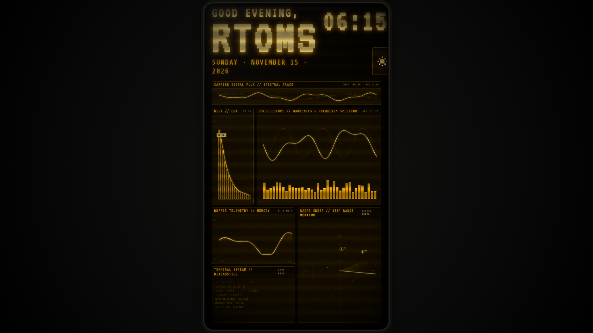
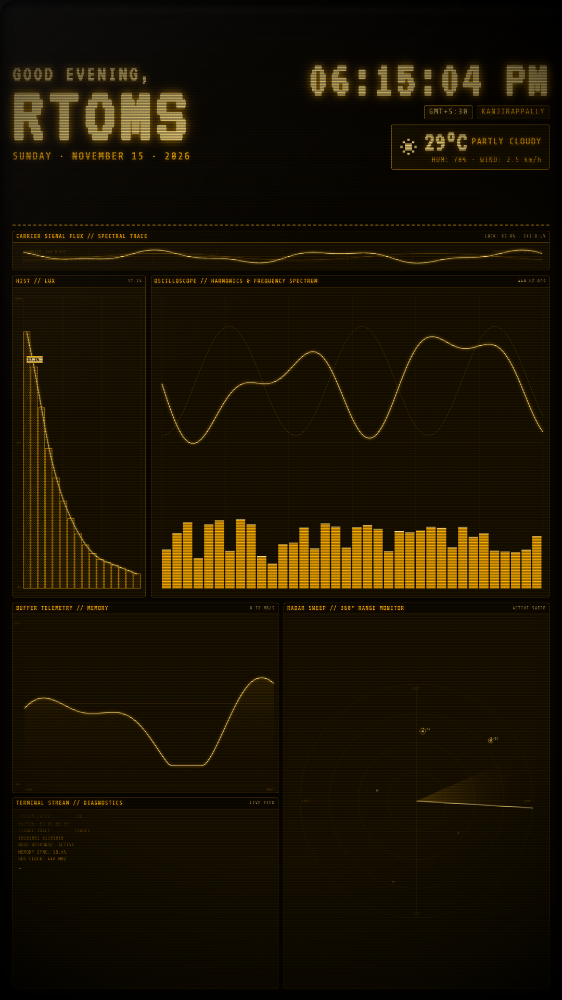
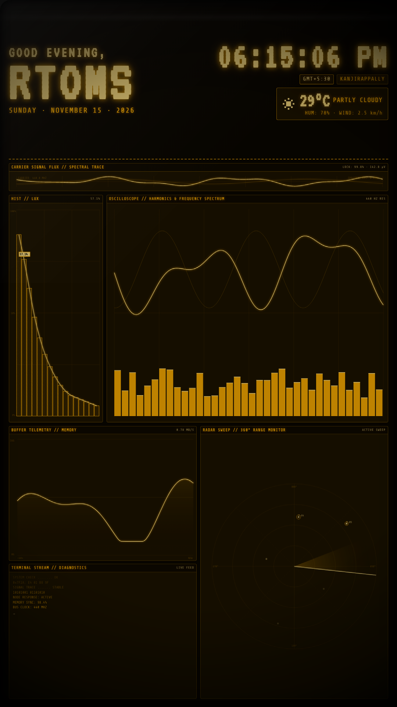
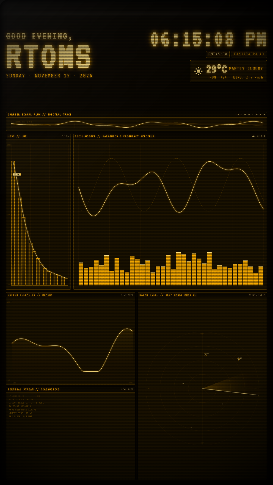

# RTOMS - Retro CRT Ambient Dashboard & Screensaver

RTOMS is an authentic, retro CRT ambient dashboard and screensaver engineered for vertical 9:16 portrait monitors, mobile docks, and desktop kiosk setups. It evokes vintage amber phosphor terminals, NASA mission-control displays, oscilloscope instrumentation, and early telemetry systems.

The entire interface operates as one continuous convex CRT glass surface with realistic barrel distortion, horizontal phosphor scanlines, fine raster textures, cathode ray beam sweeps, and phosphor bloom glow.

Built entirely with pure vanilla web technologies: zero external dependencies, no node build steps, no heavy frameworks, and full offline resilience.

---

## Visual Previews

### Portrait Mode (Amber Phosphor - Default)


### Landscape Desktop Terminal View


### Green Phosphor (VT220 Terminal Aesthetic)


### Cyan Phosphor (Telemetry & Radar Mode)


### Monochrome Phosphor (P4 High-Contrast White)


---

## Core Features

- Continuous Convex CRT Optical Surface: Barrel pincushion glass curvature, radial corner vignette, horizontal phosphor scanlines, fine sub-pixel dot raster, and periodic vertical refresh beam sweeps.
- Four Phosphor Color Themes: Amber (warm P3 phosphor default), Green (DEC VT220 style), Cyan (radar telemetry style), and Monochrome (P4 high-contrast white). Cycle with the T key or through the bottom HUD. Theme preference is automatically persisted to local storage.
- Global Animation Speed Multiplier: Users can adjust animation speeds across all charts synchronously via the S key or bottom HUD. Four presets: 0.5x (Very Slow, Default), 0.75x (Slow), 1.0x (Normal), and 1.5x (Fast). Selection is automatically persisted.
- Two-Sided Asymmetric Header:
  - Top Left: Big prominent greeting ("GOOD MORNING, RTOMS" / "GOOD EVENING, RTOMS" according to local time) and formatted calendar date.
  - Top Right: Large real-time digital clock with seconds, local timezone tag, live Open-Meteo weather for Kanjirappally (Kerala, India) featuring custom pixel-art SVG weather icons, temperature, humidity, and wind conditions.
- Middle Carrier Signal Flux Monitor: Wide spectral trace banner graph featuring dual-band rolling waveforms, carrier lock telemetry, and real-time amplitude metrics.
- 4-Column Upper Telemetry Stage:
  - 1 Column: Cross-hatched histogram with diagonal hatched fill, spline curve envelope, and dynamic peak percentage tag.
  - 3 Columns: Wide harmonics oscilloscope waveform with composite sinusoidal harmonics and full-width frequency spectrum analyzer bars.
- Lower Telemetry Split Section:
  - Left Column Top: Half-height rolling memory and buffer telemetry line graph.
  - Left Column Bottom: Continuous procedural terminal-text diagnostic stream with real-time typewriter character printing, hex addresses, binary sequences, and auto-scrolling phosphor lines.
  - Right Column: Large 360-degree circular radar sweep with rotating beam, range rings, cardinal headings, and persistent target blips.
- Kiosk Mode & Power Management: Includes Windows launch script, HTML5 Fullscreen API toggling, and Screen Wake Lock API integration to prevent display sleep during multi-hour kiosk runs.
- Bottom-Edge Auto-Hiding HUD: Control panel remains hidden during normal ambient operation. Moving the mouse cursor near the bottom edge reveals frosted glass control buttons. Mouse cursor automatically hides after 2.8 seconds of inactivity.

---

## Keyboard Controls & Shortcuts

| Key | Action | Description |
| :--- | :--- | :--- |
| T | Cycle Theme | Switches between Amber, Green, Cyan, and Monochrome |
| S | Cycle Speed | Adjusts animation speed: 0.5x, 0.75x, 1.0x, 1.5x |
| Space | Pause / Live | Freezes or resumes telemetry graphs and oscilloscope waves |
| F | Fullscreen | Toggles full-screen display mode |
| R | Refresh Weather | Forces an immediate Open-Meteo weather update |
| H | Toggle CRT Optics | Switches between curved convex CRT glass and flat presentation |
| Alt + F4 | Exit Kiosk | Closes kiosk browser window on Windows systems |
| Esc | Exit Fullscreen | Returns from fullscreen to regular browser window |

---

## How to Customize and Make It Yours

RTOMS was designed to be easily customized. All styling, parameters, and telemetry data are modular.

### 1. Changing the Call Sign / Name
To change the main heading from "RTOMS" to your own name or handle:
- In `index.html`, locate:
  ```html
  <span class="brand-rtoms">RTOMS</span>
  ```
  Replace `RTOMS` with your desired name (for example, `ALEX`, `NOVA`, or `ARCH`).

### 2. Changing the Weather Location
By default, RTOMS displays live weather for Kanjirappally, Kerala, India (coordinates: latitude 9.55, longitude 76.78).

To configure your own city:
1. Open `dashboard.js` and locate the `fetchWeather` function around line 223:
   ```javascript
   const lat = 9.55;  // Replace with your latitude
   const lon = 76.78; // Replace with your longitude
   ```
2. In `index.html`, update the location badge in the header:
   ```html
   <span class="badge loc-badge">KANJIRAPPALLY</span>
   ```
   Replace `KANJIRAPPALLY` with your city name.
3. If offline, the dashboard falls back gracefully to default temperature and weather data defined in `dashboard.js`.

### 3. Adding or Modifying Phosphor Themes
Color palettes are defined via CSS custom properties in `style.css` and matching theme definitions in `dashboard.js`.

To modify the default Amber color or add your own palette:
- In `style.css`, edit the CSS variables under `:root` or create a new `body[data-theme="your-theme"]` block:
  ```css
  body[data-theme="purple"] {
    --bg: #09000a;
    --primary: #d442f5;
    --highlight: #f3a6ff;
    --muted: rgba(212, 66, 245, 0.32);
    --dim: rgba(212, 66, 245, 0.08);
    --border: rgba(212, 66, 245, 0.28);
    --border-strong: rgba(212, 66, 245, 0.6);
  }
  ```
- In `dashboard.js`, append your theme definition to the `themes` array:
  ```javascript
  {
    id: 'purple',
    name: 'Purple',
    bg: '#09000a',
    primary: '#d442f5',
    highlight: '#f3a6ff',
    muted: 'rgba(212, 66, 245, 0.32)',
    dim: 'rgba(212, 66, 245, 0.08)'
  }
  ```

### 4. Customizing Telemetry & Speed Presets
All procedural charts are generated inside `telemetry.js`:
- To adjust the histogram bars, edit `initHistogramData()` in `telemetry.js`.
- To alter the harmonics and speed of the oscilloscope, adjust `renderOscilloscope()`.
- To configure default animation speed, modify `this.speedMultiplier = 0.5;` in `telemetry.js` or `speedPresets` in `dashboard.js`.

---

## Windows Kiosk Setup & Deployment

A ready-to-run Windows launcher is provided in `launch-kiosk.bat`.

### Launching in Kiosk Mode
1. Clone or download this repository onto your Windows machine:
   ```bash
   git clone https://github.com/rtomswastaken/rtoms-screensaver.git
   ```
2. Double-click `launch-kiosk.bat`.
3. The dashboard will launch in Microsoft Edge (or Google Chrome) in true fullscreen kiosk mode, hiding all address bars, tabs, toolbars, and system borders.

### Exiting Kiosk Mode
- Press `Alt + F4` to exit the kiosk application at any time.

### Windows Power Configuration for Dedicated Kiosks
If running this application on a dedicated vertical secondary monitor or kiosk laptop:
1. Open Windows Settings -> System -> Power & Sleep.
2. Set "When plugged in, turn off screen after" to "Never".
3. Set "When plugged in, PC goes to sleep after" to "Never".
4. The dashboard automatically requests a browser Screen Wake Lock when active.

---

## Technical Specifications

- Rendering Engine: Pure HTML5 Canvas 2D with Retina/DPR scaling support.
- CSS Architecture: Continuous 3D convex CRT transformation pipeline with CSS custom property theming.
- Network Dependencies: Zero external runtime dependencies. Fallback monospace fonts ensure 100% offline capability.
- Weather Service: Open-Meteo REST API (public free tier, no API key required).
- Frame Rate: Consistent 60 FPS update cycle driven by `requestAnimationFrame`. Automatically throttles when the browser tab is hidden to conserve power.

---

## File Structure

```
rtoms-screensaver/
├── index.html          # Semantic CRT markup and chassis structure
├── style.css           # CRT optical shaders, animations, and phosphor themes
├── dashboard.js        # Clock, greeting, weather API, theme/speed persistence, and HUD
├── telemetry.js        # Canvas 2D engines for histogram, oscilloscope, flux, radar, and terminal
├── launch-kiosk.bat    # Windows batch launcher for Edge/Chrome kiosk mode
├── README.md           # Documentation, customization guide, and setup instructions
├── .gitignore          # Git exclusion rules
└── docs/
    └── screenshots/    # High-resolution previews for all phosphor themes
```

---

## License

MIT License. Free to use, adapt, and build upon.
